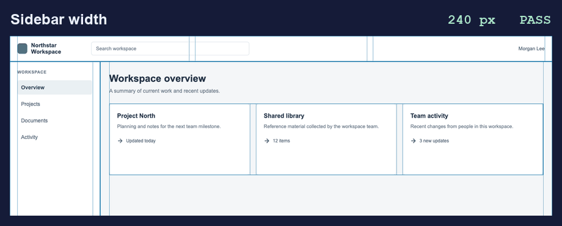

<a href="https://ceebee.biz.id">
  <picture>
    <source media="(prefers-color-scheme: dark)" srcset="https://ceebee.biz.id/brand/byceebee/byceebee-stacked-inverse.svg">
    
  </picture>
</a>

## Who we are

**Small ideas. Useful products.**

byceebee is an indie studio. We make products for collecting, getting around, and everyday life. This GitHub is where we share tools we build along the way.

[Explore the studio catalog](https://ceebee.biz.id)

## Layout Witness

Keep layout guides visible while your dev server is running. Check alignment, spacing, and component geometry against rules you define. Give your coding agent the overlay and a JSON report so it can make a specific correction and check it again.



```sh
npx skills add byceebee/skills --skill ceebee-layout-witness
```

[Open Layout Witness setup and examples](https://github.com/byceebee/skills#readme)

<details>
<summary>What the demo checks</summary>

The page asks for a 240 px sidebar. A CSS edit pushes it to 260 px, and Layout Witness marks the edge and reports the measured width. Correcting the CSS clears the finding in the same watch session.

</details>
