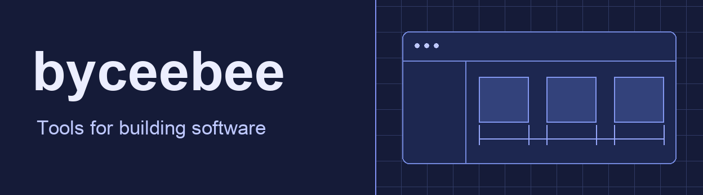

# byceebee

[](https://github.com/byceebee/skills)

We build tools for developers and coding agents who work on real applications.

## Layout Witness

Keep layout guides visible while your dev server is running. Check alignment, spacing, and component geometry against rules you define. Give your coding agent the overlay and a JSON report so it can make a specific correction and check it again.


```sh
npx skills add byceebee/skills --skill ceebee-layout-witness
```

[Setup and examples](https://github.com/byceebee/skills#readme) · [Browse the skill collection](https://github.com/byceebee/skills/tree/main/skills)

<details>
<summary>What the demo checks</summary>

The page asks for a 240 px sidebar. A CSS edit pushes it to 260 px, and Layout Witness marks the edge and reports the measured width. Correcting the CSS clears the finding in the same watch session.

</details>
